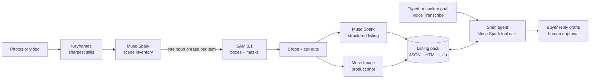

# Off My Shelf

<!-- GIF of the app goes here (S5). -->

**Film the things you no longer use. Get ready-to-post listings, sorted into sell, donate and
recycle.**

Live demo: _URL coming in S3_ · Demo video: _coming in S5_

Off My Shelf turns a photo or a short video of a shelf into one listing per item: what it is,
its condition, a fair second-hand price, a title and description in English, French or Turkish,
a clean product shot, and a sell / donate / recycle decision. An agent then acts on the whole
pack from a typed or spoken goal ("I'm moving on Friday: sell the electronics fast, give the
books away") and drafts replies to buyers that a person approves before sending.

## Quickstart

```
uv sync
copy .env.example .env      # Linux/macOS: cp .env.example .env, then add META_API_KEY
uv run off-my-shelf serve   # open http://127.0.0.1:8000
```

No key yet? `serve` still runs offline: **Try the demo** loads a bundled example pack.

## How it works



| Meta model | What it does here |
| --- | --- |
| **Muse Spark 1.3** | Lists the items in each photo; writes each listing as schema-checked JSON; drives the agent's tool calls |
| **SAM 3.1** | Finds and masks each listed item from its noun phrase |
| **Muse Image 1.0** | Turns each cut-out into a clean product shot, keeping real wear and defects |
| **Muse Voice Transcribe 1.0** | Turns a spoken goal ("sell fast, donate the books") into text for the agent |
| **Muse Spark Open** (optional) | Runs the listing step on open weights at a partner endpoint (`OMS_USE_SPARK_OPEN=true`) |

Every model result is cached on disk by input hash, so a re-run costs nothing and a demo
replays without network.

## Command line

```
uv run off-my-shelf run photos/ --out packs/shelf --lang fr   # photos or videos -> pack
uv run off-my-shelf agent packs/shelf "moving Friday: sell fast, donate the books"
uv run off-my-shelf agent packs/shelf --buyer item-001 "Would you take 5 euros?"
uv run off-my-shelf export packs/shelf                        # HTML page + zip
uv run off-my-shelf eval data/eval/items.csv                  # mini eval report
uv run python -m off_my_shelf.smoke spark                     # one live call per model
```

## Safety by design

- Buyer replies are drafts: the agent cannot send anything, a person approves each one.
- Every agent action is checked before it applies: a reply is rejected if it goes below the
  item's floor price or moves contact or payment off the marketplace, and the agent is told why.
- AI product shots are labelled as such, next to the real photo of the actual item.

## Cost and latency per item

| Step | Model | Cost per item (list price) | Latency |
| --- | --- | --- | --- |
| Inventory (shared by items in a photo) | Muse Spark | _to measure_ | _to measure_ |
| Segmentation | SAM 3.1 | $0.0025 per phrase | _to measure_ |
| Listing | Muse Spark | _to measure_ | _to measure_ |
| Product shot | Muse Image | $0.01 | _to measure_ |

## Evaluation

_Numbers from `off-my-shelf eval` on about 30 real items with known resale prices (S7)._

## Development

```
uv run pre-commit install
uv run pre-commit run --all-files
uv run pytest
```

Runs on Windows and Linux; CI tests both. See [AGENTS.md](AGENTS.md) for repository
conventions and [NEW_IN_HACKATHON.md](NEW_IN_HACKATHON.md) for what was built during the
hackathon.

## License

[AGPL-3.0-only](LICENSE)
