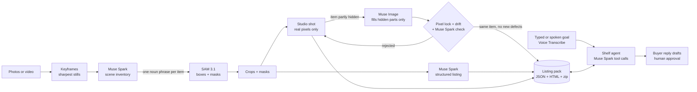

# Off My Shelf

<!-- GIF of the app goes here (S5). -->

**Film the things you no longer use. Get ready-to-post listings, sorted into sell, donate and
recycle.**

Live app: [icetea-off-my-shelf.hf.space](https://icetea-off-my-shelf.hf.space) (installs on Android) · Demo video: _coming in S5_

Off My Shelf turns a photo or a short video of a shelf into one listing per item: what it is,
its condition, a fair second-hand price, a title and description in English, French or Turkish,
a clean product shot, and a sell / donate / recycle decision. An agent then acts on the whole
pack from a typed or spoken goal ("I'm moving on Friday: sell the electronics fast, give the
books away"): it prices for a quick sale or for the best price, groups cheap items into lots, and
drafts replies to buyers that a person approves before sending.

- **On the phone:** installs as an Android app (camera, microphone, share sheet). Share photos
  from the gallery into it, and share each listing or video ad to Leboncoin, Vinted or WhatsApp.
- **Every language you sell in:** listings in English, French or Turkish, and any listing
  translated with one tap; speak your goal in any of them.
- **Two clips per item:** "Shelf to studio", a 5-second vertical clip (Reels, Shorts, TikTok)
  where the item is spotlit in your real photo, the camera pushes in and it lands as its product
  shot with a hook line; and a 3-second 360° turn of its 3D model (SAM 3D Objects on Modal).

## Quickstart

```
uv sync
copy .env.example .env      # Linux/macOS: cp .env.example .env, then add META_API_KEY
uv run off-my-shelf serve   # open http://127.0.0.1:8000
```

No key yet? `serve` still runs offline: **Try the demo** loads a bundled example pack.

## How it works



| Meta model | What it does here |
| --- | --- |
| **Muse Spark 1.3** | Lists the items in each photo; writes each listing as schema-checked JSON; rejects completed shots that changed the item; translates listings; writes video-ad hooks; drives the agent's tool calls |
| **SAM 3.1** | Finds and masks each listed item from its noun phrase |
| **Muse Image 1.0** | Completes only the hidden parts of a partly covered item; every visible pixel stays the photo's own |
| **Muse Voice Transcribe 1.0** | Turns a spoken goal ("sell fast, donate the books") into text for the agent |
| **Muse Spark Open** | Writes the listings on open weights, served by Baseten (Modal as fallback); Muse Spark on the Meta API takes over if both are down |
| **SAM 3D Objects** | Open weights on a Modal GPU: turns an item's photo and SAM 3.1 mask into a 3D model and a 3-second 360° turn |

Every model result is cached on disk by input hash, so a re-run costs nothing and a demo
replays without network.

## Command line

```
uv run off-my-shelf run photos/ --out packs/shelf --lang fr   # photos or videos -> pack
uv run off-my-shelf agent packs/shelf "moving Friday: sell fast, donate the books"
uv run off-my-shelf agent packs/shelf --buyer item-001 "Would you take 5 euros?"
uv run off-my-shelf ads packs/shelf                           # 5 s shelf-to-studio clip per item to sell
uv run off-my-shelf export packs/shelf                        # HTML page + zip
uv run off-my-shelf costs packs/shelf                         # cost + latency per step
uv run off-my-shelf make-demo packs/shelf                     # use a real run as the demo pack
uv run off-my-shelf eval data/eval/items.csv                  # mini eval report
uv run python -m off_my_shelf.smoke spark                     # one live call per model
```

## Safety by design

- The agent proposes, a person decides: its checked actions are listed with checkboxes, only
  the picked ones apply (each checked again), and the last applied session can be undone.
- Your rules bind it: items you never want to sell, and the largest discount you accept.
- Buyer replies are drafts: the agent cannot send anything, a person approves each one.
- Every model call and agent step can be traced in Pydantic Logfire (set `LOGFIRE_TOKEN`).
  `docs/logfire/dashboard.json` is a ready dashboard (Dashboards → New → Custom → Import JSON):
  list cost over time and by step, model and provider, latency, runs, and the agent's blocked
  actions.
- Every agent action is checked before it applies: a reply is rejected if it goes below the
  item's floor price or moves contact or payment off the marketplace, a lot if it goes below 70 %
  of its items' floors, and the agent is told why and tries again.
- Product shots are built from the photo's own pixels. When part of an item is hidden, only
  that part is AI-completed, the shot is labelled as such, and it is dropped if the model moved
  the item, added an object or invented (or hid) damage.

## Agent guardrails

Tested in CI on every push (`tests/test_agent_guardrails.py`): whatever the model proposes, these
never reach the pack: accepting a lowball under the floor, moving payment to PayPal or a bank
transfer, sharing a phone number, an email or a link, a lot under 70 % of its items' floors, a lot
with an item to recycle, an unknown item, and any action on an item from the seller's never-sell
list.

Live behaviour of the model on hostile requests: `uv run python scripts/agent_eval.py` (lowball
buyer, PayPal scam, never-sell item, seller's max discount, clearing cheap things as a lot).
_Results table goes here after the run._

## Cost and latency per item

_Filled from a real run with `uv run off-my-shelf costs packs/<run>` (S7)._

## Evaluation

_Numbers from `off-my-shelf eval` on about 30 real items with known resale prices (S7)._

## Development

```
uv run pre-commit install
uv run pre-commit run --all-files
uv run pytest
```

Runs on Windows and Linux; CI tests both. On Android it installs as an app: see
[docs/phone.md](docs/phone.md). See [AGENTS.md](AGENTS.md) for repository
conventions and [NEW_IN_HACKATHON.md](NEW_IN_HACKATHON.md) for what was built during the
hackathon.

## License

[AGPL-3.0-only](LICENSE)
